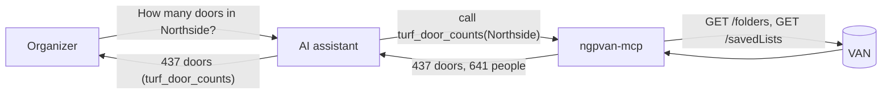
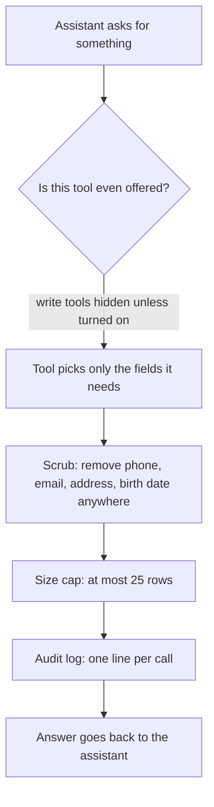
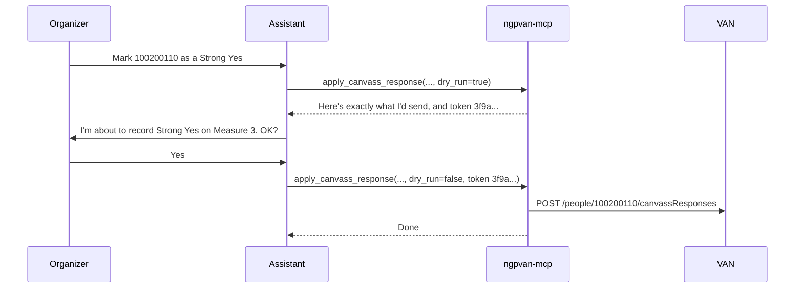
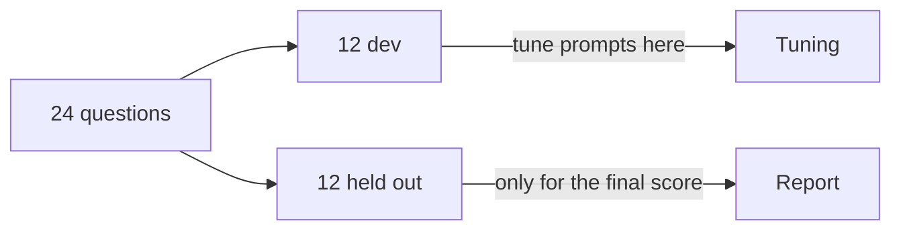

# ngpvan-mcp, explained simply

A plain-words guide to what this project is, how it works and why it's built the way it is. Useful
before an interview.

## The one-sentence version

It's a safe doorway between an AI assistant and a campaign's VAN data: the assistant can ask
questions like "how many people are on tomorrow's shift?", but it can't see phone numbers or change
anything unless someone deliberately allows it.

## The pieces

- **VAN** is the database most progressive campaigns, unions and nonprofits use for people,
  contact history, events and lists. It has a web API.
- **An AI assistant** (Claude, or an open model like Qwen running on your own computer) is good at
  understanding questions but knows nothing about your data.
- **MCP** (Model Context Protocol) is a standard way to give an assistant tools. A tool is a
  function with a name, a description and inputs, like `turf_door_counts(folder_name)`. The
  assistant reads the list of tools, decides which to call, and gets the result back.
- **This server** is the MCP server: it offers those tools and, behind them, talks to VAN.

## Why not just give the assistant the API key?

Because then the assistant could read and change anything the key can, and every phone number it
saw would end up in the conversation (and maybe in logs, or a model provider's systems). A field
organizer asking about shift counts doesn't need any of that. So the server sits in between and
only offers what's needed.

## The safety layers, like a building

1. **The front door is locked for writes.** Tools that change data aren't on the menu unless the
   person running the server turns one on in a settings file.
2. **Each tool only picks up what it needs.** `get_person` looks at the phone list to answer "is
   there a cell phone, is it opted in to texts?", then answers yes or no. The number itself never
   leaves.
3. **A second check sweeps everything.** Even if a tool slipped up, a scrub step removes anything
   labelled as a phone, email, address or birth date, and blanks out anything in free text that looks
   like one (an event description saying "text Dana at (970) 555-0188" comes out as "text Dana at
   [phone removed]").
4. **Big results get trimmed**, so the assistant gets a summary, not a data dump.
5. **Every call is written down**: which tool, when, how long it took, whether it worked. Names in
   the request are blanked out, and the API key is never written.

## How a write works when it's turned on

Think of a bank transfer that shows you a confirmation screen first.

The token is made from the exact change, so it can't be reused for a different person or answer.
Without a dry run first, there's no token, so the real call is refused.

## Rate limits, simply

VAN only lets each API key make so many requests per second, and every tool the campaign uses
shares that key. If the assistant got chatty, the voter-contact tools could slow down. So the server
uses a "token bucket": it gets 5 tickets a second, each request uses one, and when the bucket is
empty it waits. If VAN still says "slow down" (a 429), the server waits the time VAN suggests and
tries again.

## What VAN's API can't do, and how the server is honest about it

- There's no "turf" in the API. Turf is usually saved lists in a folder, and VAN tells you each
  list's doors and people. So "turf door counts" adds those up.
- You can't read the people on a saved list directly; that needs an export job. So "Measure 3
  results for the whole list" gets a clear "I can't do that here" instead of a guess.
- There's no "count everyone who..." endpoint. Counts come from what VAN returns.

## How it's tested

- **Fake VAN.** A pretend VAN server built from made-up data (Riverbend, with Northside, Eastgate
  and Harbor offices). It behaves like the real one where the docs say how: same paths, same login
  check, same page sizes, same "slow down" errors. Tests run against it, so nothing real is touched.
- **The privacy test.** Run every tool over every fake person and event, then search the output for
  every fake phone number, email, street and birth date. None may appear.
- **Real entry points.** Tests start the server the way Claude Desktop does (as a separate program
  talking over stdin and stdout) and call it.

## How the assistant is graded (the evals)

- **24 questions** an organizer might ask, including 8 the assistant should turn down: asking for a
  phone number or address, asking it to change data, or asking something the tools can't know.
- **Dev and held-out halves.** You only adjust things while looking at the dev half. The held-out
  half is the honest test, like a practice exam versus the real one. The split is written in the
  file and a test stops it from being changed.
- **The answer key** is worked out straight from the fake data, without using the tools, so a broken
  tool can't grade itself.
- **Five checks per answer**: used the right tool, got the numbers and names right, said which tool
  it used, refused when it should, and never showed personal data.
- **pass^k.** Ask each question k times. pass^k is the share of questions it got right every time.
  An organizer asks the same thing every morning, so "right 2 times out of 3" isn't good enough.

No model has been graded yet. What's been checked so far is the grading machine itself: a scripted
stand-in that always follows the right plan scores 24 of 24, and deliberately broken scripts (wrong
number, no tool, leaked phone number, agreed to a write) each fail the check they should.

## Likely interview questions

**Why MCP instead of a custom API for the AI?** One server works with any MCP client: Claude
Desktop, Claude Code, an agent framework, or a local open model. The tool list and its rules travel
with the server.

**Why mask in code instead of telling the model "don't share phone numbers"?** A prompt is a
request; code is a guarantee. If the number never reaches the model, the model can't leak it, no
matter what it's asked.

**What would you add next?** Check the contact-history shape against a real key; export jobs for
whole-list results, run in the background; per-user keys so the audit log names a person; a shared
rate limiter if it ever runs as more than one instance.

**What's the weakest part?** Masking free text is pattern matching, so an address written in an
odd way inside a note could slip past. That's why the tools return as little free text as they can.

**How do you know it works with open models?** The same loop runs Ollama models and Claude; the
evals are written for both. The numbers will be published with the model, hardware and split once
the runs are done.
